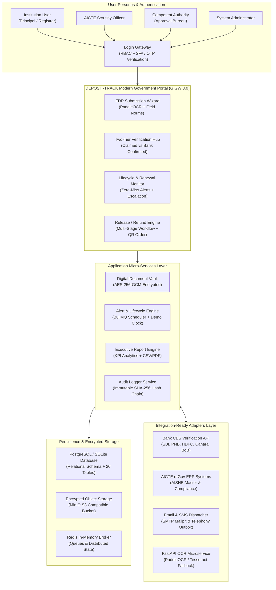

# DEPOSIT-TRACK: System Architecture Specification
**Smart India Hackathon 2026 | Problem Statement: SIH26265 (AICTE Context) | Team StrataXX**
*Tagline: "One portal for every deposit, from submission to release."*

---

## 1. Architectural Blueprint (Matching SIH Presentation Slide 2)

---

## 2. Core Architectural Pillars

### 2.1 Two-Tier Trust Layer (Verified vs Claimed)
Every deposit record carries an unambiguous verification badge:
- 🟠 **"Submitted by Institution" (Claimed):** The instrument has been registered by the institution but has not yet been corroborated against the bank's core ledger.
- 🟢 **"Confirmed by Bank" (Verified):** The instrument has been validated against the bank Core Banking System (CBS) via automated API query or signed confirmation letter upload.
- 🔴 **"Discrepancy Flagged":** A field divergence (amount mismatch, date misalignment, duplicate FDR number) was detected.

### 2.2 Immutable Cryptographic Audit Trail
Audit rows are sequentially hash-chained using SHA-256:
$$\text{currHash}_i = \text{SHA-256}(\text{Entity} \mathbin{\Vert} \text{Action} \mathbin{\Vert} \text{Actor} \mathbin{\Vert} \text{Timestamp} \mathbin{\Vert} \text{State} \mathbin{\Vert} \text{prevHash}_{i-1})$$

The genesis record initiates at tip `0000000000000000000000000000000000000000000000000000000000000000`. Any unauthorized direct modification of a row in the database breaks the mathematical chain at record $i+1$, immediately detected by the portal's verification engine.

### 2.3 Application-Layer Encryption at Rest
All documents uploaded to the Digital Document Vault are encrypted using AES-256-GCM before transfer to MinIO or local storage. Files are decrypted on-the-fly only when authorized personnel with matching tenant permissions request access, and every download creates an entry in `DocumentAccessLog`.
